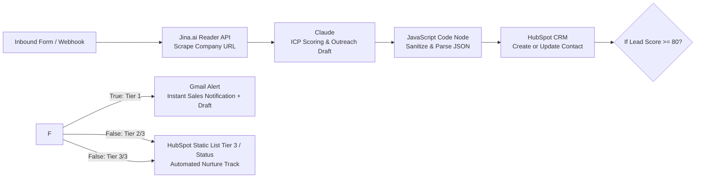

# Inbound Lead Enrichment & Routing (Claude + HubSpot + Gmail)

An end-to-end RevOps and Marketing Operations automation built in **n8n** that ingests inbound form submissions, scrapes live prospect company websites via **Jina.ai**, evaluates Ideal Customer Profile (ICP) fit using **Claude**, deduplicates and enriches records in **HubSpot**, and routes leads into instant sales alerts or automated nurture tracks in under 10 seconds.

>**[Watch the Live Walkthrough](https://www.loom.com/share/444dec4761a04800836e03c7f413ef8b)**

---

## Business Problem & Impact

Manual inbound lead qualification slows down speed-to-lead, creates inconsistent scoring across reps, and forces SDRs to spend 15–20 minutes researching form fills before sending a first touch communication.

| Metric / Process | Manual Sales Process | Automated AI RevOps Pipeline |
| :--- | :--- | :--- |
| **Account Research** | Manual website & LinkedIn review | **Automated Markdown extraction (Jina.ai)** |
| **Lead Qualification** | Subjective rep judgment | **Standardized 0–100 LLM rubric (Claude)** |
| **CRM Hygiene** | Manual entry; high duplicate risk | **Email-keyed Upsert (Create or Update)** |
| **First-Touch Outreach** | Written from scratch per lead | **Pre-drafted, pain-point-specific copy** |

---

## System Architecture

